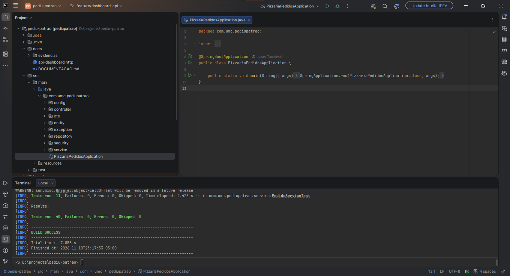
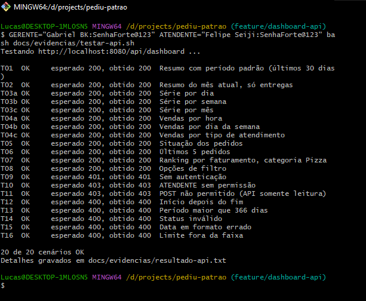

# Dashboard Administrativo do Pediu Patrão

**Documento de análise, projeto, API e testes**

**Vídeo de apresentação** | _link do vídeo_ 

## Sumário

1. [Contexto e objetivo](#1-contexto-e-objetivo)
2. [Requisitos funcionais](#2-requisitos-funcionais)
3. [Requisitos não funcionais](#3-requisitos-não-funcionais)
4. [Análise e modelagem dos dados](#4-análise-e-modelagem-dos-dados)
5. [Projeto da solução](#5-projeto-da-solução)
6. [Documentação dos endpoints](#6-documentação-dos-endpoints)
7. [Testes e evidências](#7-testes-e-evidências)
8. [Dashboard funcional](#8-dashboard-funcional)
9. [Fluxo de versionamento (Gitflow)](#9-fluxo-de-versionamento-gitflow)
10. [Principais decisões e limitações](#10-principais-decisões-e-limitações)

---

## 1. Contexto e objetivo

O Pediu Patrão é um sistema de pedidos para pizzaria/lanchonete em **Java 21, Spring Boot 3.4, Spring Security, Thymeleaf e MongoDB Atlas**. Ele já registrava clientes, produtos e pedidos com itens, valores calculados no servidor, fluxo de status controlado, perfis de acesso (ADMIN, GERENTE, ATENDENTE) e auditoria.

O objetivo desta etapa foi criar um **Dashboard Administrativo** para o responsável pelo estabelecimento acompanhar o desempenho das vendas, ver a situação dos pedidos e identificar tendências da operação, consumindo uma **API projetada e implementada para isso**.

**Público do dashboard:** ADMIN (dono) e GERENTE. O ATENDENTE não tem acesso, porque os números de faturamento são informação gerencial.

---

## 2. Requisitos funcionais

| ID | Requisito | Descrição detalhada | Critério de aceite |
|---|---|---|---|
| **RF01** | Indicadores gerais de vendas | Mostrar faturamento, quantidade de pedidos, ticket médio e taxa de cancelamento do período, comparados com o período anterior de mesma duração. Mostrar também total de pedidos, cancelados, itens vendidos e descontos concedidos. | Cancelados não somam no faturamento. A variação aparece com seta e sinal; sem período anterior, aparece "sem base". |
| **RF02** | Análise de vendas (gráficos) | Gráfico da evolução de faturamento, pedidos ou ticket médio, agrupado por dia, semana ou mês; distribuição por hora do dia; por dia da semana; e por tipo de atendimento (entrega x retirada). | Dias, horas e semanas sem venda aparecem com zero. Semana ou mês cortado pelo filtro gera aviso. |
| **RF03** | Situação dos pedidos | Quantidade por status, pedidos em andamento, pedidos atrasados, tempo médio de atendimento e lista dos últimos pedidos, com destaque para os atrasados. | Atrasado = em andamento há mais de 40 min (configurável). Tempo médio considera só pedidos finalizados. |
| **RF04** | Produtos mais vendidos | Ranking dos produtos por quantidade ou por faturamento, com categoria e participação no faturamento, limitado a top 5, 10 ou 20 e filtrável por categoria. | Itens de pedidos cancelados não entram. Produto excluído do cadastro continua no histórico. |
| **RF05** | Filtros de consulta | Filtrar todos os indicadores por período (início e fim), status e tipo de atendimento. Atalhos: hoje, 7 dias, 30 dias e mês atual. | Padrão: últimos 30 dias. Início posterior ao fim e período maior que 366 dias são recusados. |
| **RF06** | Integração com a API | A tela não faz cálculos: todos os números vêm de endpoints REST próprios, consumidos via `fetch`. | Todos os cards são alimentados por `/api/dashboard/*`. |
| **RF07** | Atualização e tratamento de dados | Atualização automática a cada 60 s (desligável) e manual; horário da última atualização; estados de carregando, vazio e erro por card; validação dos parâmetros; tolerância a dados antigos ou incompletos. | Falha em um endpoint afeta só o seu card. Parâmetro inválido retorna 400 com mensagem clara. Valor nulo não gera erro. |

---

## 3. Requisitos não funcionais

| ID | Categoria | Requisito | Como foi atendido |
|---|---|---|---|
| **RNF01** | Segurança | Somente ADMIN e GERENTE acessam o dashboard e sua API. | Regra no `SecurityConfig` (`/dashboard` e `/api/dashboard/**`) e reforço com `@PreAuthorize` no controller. Sem login: 401. ATENDENTE: 403, registrado na auditoria. |
| **RNF02** | Segurança | A API do dashboard é somente leitura. | Apenas `GET`; qualquer outro método em `/api/dashboard/**` é negado (`denyAll`). |
| **RNF03** | Segurança | Não expor dados desnecessários nem permitir injeção de HTML. | DTOs próprios (ex.: `PedidoRecente` não expõe responsáveis nem justificativas). A tela escapa todo texto vindo da API (`escapeHtml`). |
| **RNF04** | Desempenho | Consultas rápidas para o volume de uma pizzaria. | Filtro de período, status e atendimento aplicado no MongoDB, com índice em `dataHoraEntrada`. Período máximo de 366 dias. Limite de 50 itens em listas. |
| **RNF05** | Confiabilidade | Valores monetários exatos. | `BigDecimal` com arredondamento `HALF_UP` em todos os cálculos; nada de `double` para dinheiro. |
| **RNF06** | Confiabilidade | Dados incompletos não podem derrubar o painel. | Valor nulo conta como zero, cliente sem nome vira "(sem nome)", item sem `produtoId` é agrupado pelo nome, pedido sem data de entrada é ignorado. |
| **RNF07** | Usabilidade | Painel legível e responsivo. | Bootstrap 5, cards com indicadores no topo, gráficos com tooltip, layout que se reorganiza em telas menores. Variações com seta e texto, não só cor. |
| **RNF08** | Manutenibilidade | Regras de negócio isoladas e testáveis. | `DashboardCalculadora` sem dependência de Spring ou banco, coberta por testes unitários. Padrão em camadas mantido (controller, service, DTO). |
| **RNF09** | Interoperabilidade | API REST com contrato claro. | JSON, datas ISO-8601 (`AAAA-MM-DD`), enums por nome, erros padronizados em `ErroResponse`. |
| **RNF10** | Portabilidade e configuração | Configuração fora do código. | Limite de atraso e carga de demonstração por variável de ambiente (`.env`), como o restante do projeto. |

---

## 4. Análise e modelagem dos dados

### 4.1 De onde vem cada informação

Antes de criar endpoints, mapeei o que cada requisito precisa. Todos os dados já existiam na coleção `pedidos`, por isso **a entidade `Pedido` não foi alterada**. A única mudança no banco foi um **índice**.

```
pedidos (coleção existente)
├── dataHoraEntrada ........ RF02 séries, hora, dia da semana; RF05 período   ← índice novo
├── status ................. RF01 cancelados; RF03 situação; RF05 filtro
├── tipoAtendimento ........ RF02 entrega x retirada; RF05 filtro
├── valorTotal ............. RF01 faturamento e ticket; RF02 todos os gráficos
├── valorDesconto .......... RF01 descontos concedidos
├── dataHoraFinalizacao .... RF03 tempo médio de atendimento
├── clienteNome ............ RF03 últimos pedidos
└── itens[] ................ RF01 itens vendidos; RF04 ranking
    ├── produtoId, nomeProduto
    ├── quantidade
    └── subtotal (preço gravado no pedido x quantidade)

produtos (coleção existente)
└── tipo ................... RF04 categoria do produto e filtro por categoria
```

### 4.2 Regras de negócio levantadas

| Regra | Justificativa |
|---|---|
| Pedido **cancelado não é venda**: fica fora do faturamento, ticket, itens, gráficos de venda e ranking. Entra só na contagem e na taxa de cancelamento. | Somar cancelados inflaria o faturamento com dinheiro que não entrou. |
| **Ticket médio** = faturamento ÷ pedidos válidos. | Dividir pelo total (com cancelados) reduziria o ticket artificialmente. |
| **Período anterior** = mesmo número de dias imediatamente antes do período filtrado. | Comparar 10 dias com 30 dias não faz sentido. |
| Variação com período anterior zerado = `null` ("sem base"). | Evita divisão por zero e percentuais infinitos. |
| Taxa de cancelamento comparada em **pontos percentuais**. | Ir de 5% para 8% é "+3 p.p.", mais claro que "+60%". |
| **Atrasado** = em andamento há mais de 40 min desde a entrada. | Tempo típico de preparo de pizzaria; configurável. |
| **Ranking** usa o subtotal dos itens (antes do desconto). | O desconto é dado no pedido inteiro; ratear por produto seria arbitrário. |

---

## 5. Projeto da solução

### 5.1 Arquitetura

```
┌────────────────────────────────────────────┐
│ dashboard.html (Thymeleaf + JS + Chart.js) │   RF06: só exibe, não calcula
└──────────────────────┬─────────────────────┘
                       │ fetch GET /api/dashboard/*?inicio&fim&status&tipoAtendimento
┌──────────────────────▼─────────────────────┐
│ SecurityConfig + @PreAuthorize             │   RNF01: ADMIN e GERENTE
├────────────────────────────────────────────┤
│ DashboardController                        │   recebe e converte parâmetros
├────────────────────────────────────────────┤
│ DashboardService                           │   monta FiltroDashboard e consulta o MongoDB
├────────────────────────────────────────────┤
│ DashboardCalculadora                       │   regras de negócio puras (testáveis)
├────────────────────────────────────────────┤
│ DTOs (records)                             │   contrato da API
└──────────────────────┬─────────────────────┘
                       │ find({ dataHoraEntrada: {$gte, $lt}, status?, tipoAtendimento? })
┌──────────────────────▼─────────────────────┐
│ MongoDB Atlas: pedidos (índice), produtos  │
└────────────────────────────────────────────┘
```

### 5.2 Classes criadas e alteradas

| Arquivo | Tipo | Responsabilidade |
|---|---|---|
| `controller/DashboardController` | novo | 9 endpoints GET em `/api/dashboard` |
| `service/DashboardService` | novo | Consulta filtrada no MongoDB e repasse para a calculadora |
| `service/DashboardCalculadora` | novo | Todos os cálculos (RF01 a RF04) |
| `dto/dashboard/FiltroDashboard` | novo | Filtro com padrões e validação no construtor |
| `dto/dashboard/*` | novos | `ResumoVendas`, `PontoSerie`, `FatiaVendas`, `SituacaoPedidos`, `PedidoRecente`, `ProdutoRanking`, `OpcoesFiltro`, enums `Agrupamento` e `CriterioRanking` |
| `config/DemoDataLoader` | novo | Carga opcional de pedidos de demonstração |
| `templates/dashboard.html` | novo | Tela do dashboard |
| `config/SecurityConfig` | alterado | Regras de acesso do dashboard |
| `config/MongoInitConfig` | alterado | Criação do índice `idx_pedidos_entrada` |
| `exception/ApiExceptionHandler` | alterado | 400 para parâmetro com valor inválido |
| `controller/HomeController`, `fragments/sidebar.html` | alterados | Rota `/dashboard` e item de menu |
| `repository/PedidoRepository` | alterado | `existsByResponsavelEntrada` (usado pela carga demo) |

---

## 6. Documentação dos endpoints

### 6.1 Informações gerais

| Item | Valor |
|---|---|
| URL base | `http://localhost:8080/api/dashboard` |
| Método | `GET` em todos os endpoints |
| Autenticação | Sessão do navegador (login) ou **HTTP Basic** (`-u usuario:senha`) |
| Perfis | `ADMIN`, `GERENTE` |
| Formato | JSON (UTF-8). Datas em `AAAA-MM-DD`, data/hora em ISO-8601, valores em número decimal |

**Filtros comuns** (opcionais, aceitos por todos os endpoints, exceto `/filtros`):

| Parâmetro | Tipo | Valores aceitos | Padrão |
|---|---|---|---|
| `inicio` | data | `AAAA-MM-DD` | 29 dias antes de `fim` (30 dias no total) |
| `fim` | data | `AAAA-MM-DD`, inclusivo (até 23:59:59) | hoje |
| `status` | enum | `RECEBIDO`, `EM_PREPARACAO`, `PRONTO`, `SAIU_PARA_ENTREGA`, `RETIRADO`, `FINALIZADO`, `CANCELADO` | todos |
| `tipoAtendimento` | enum | `ENTREGA`, `RETIRADA` | todos |

Regras: `inicio` não pode ser posterior a `fim`; o período máximo é de **366 dias**.

### 6.2 Erros possíveis (todos os endpoints)

Todos os erros usam o mesmo corpo `ErroResponse`:

```json
{
  "timestamp": "2026-11-10T21:04:12.512",
  "status": 400,
  "erro": "Requisição inválida",
  "mensagem": "A data inicial não pode ser posterior à data final.",
  "caminho": "/api/dashboard/resumo",
  "detalhes": []
}
```

| HTTP | Quando acontece | `erro` | Exemplo de `mensagem` / `detalhes` |
|---|---|---|---|
| **400** | `inicio` depois de `fim` | Requisição inválida | "A data inicial não pode ser posterior à data final." |
| **400** | Período maior que 366 dias | Requisição inválida | "O período máximo de consulta é de 366 dias." |
| **400** | `limite` fora de 1 a 50 | Requisição inválida | "O limite deve estar entre 1 e 50." |
| **400** | Enum inválido (`status=ENTREGUE`) | Parâmetro inválido | "Valor inválido para o parâmetro 'status': ENTREGUE." / `["Valores aceitos: [RECEBIDO, EM_PREPARACAO, ...]"]` |
| **400** | Data em outro formato (`inicio=10/11/2026`) | Parâmetro inválido | `["Use o formato AAAA-MM-DD, por exemplo 2026-11-10."]` |
| **401** | Sem login ou senha errada | Não autenticado | "Autenticação necessária. Envie usuário e senha (HTTP Basic)." |
| **403** | Usuário ATENDENTE | Acesso negado | "Perfil sem permissão para a operação." (fica registrado na auditoria) |
| **403** | Método diferente de GET (`POST`, `DELETE`...) | Acesso negado | idem |

### 6.3 `GET /api/dashboard/resumo` (RF01)

Indicadores gerais do período e comparação com o período anterior de mesma duração.

**Requisição**
```bash
curl -u gerente01:SENHA "http://localhost:8080/api/dashboard/resumo?inicio=2026-10-12&fim=2026-11-10"
```

**Resposta 200**
```json
{
  "inicio": "2026-10-12",
  "fim": "2026-11-10",
  "faturamento": 24300.87,
  "totalPedidos": 243,
  "pedidosValidos": 223,
  "pedidosCancelados": 20,
  "taxaCancelamento": 8.2,
  "ticketMedio": 108.97,
  "itensVendidos": 675,
  "totalDescontos": 134.83,
  "comparativo": {
    "inicio": "2026-09-12",
    "fim": "2026-10-11",
    "faturamento": 22111.65,
    "pedidosValidos": 230,
    "ticketMedio": 96.14,
    "taxaCancelamento": 8.0,
    "variacaoFaturamento": 9.9,
    "variacaoPedidos": -3.0,
    "variacaoTicketMedio": 13.3,
    "diferencaTaxaCancelamento": 0.2
  },
  "atualizadoEm": "2026-11-10T20:15:00"
}
```

| Campo | Significado |
|---|---|
| `faturamento` | Soma de `valorTotal` dos pedidos não cancelados (R$) |
| `totalPedidos` / `pedidosValidos` / `pedidosCancelados` | Todos / não cancelados / cancelados |
| `taxaCancelamento` | Cancelados ÷ total × 100 (%) |
| `ticketMedio` | Faturamento ÷ pedidos válidos (R$) |
| `itensVendidos` | Soma das quantidades dos itens dos pedidos válidos |
| `totalDescontos` | Soma de `valorDesconto` dos pedidos válidos (R$) |
| `comparativo.variacao*` | Variação percentual em relação ao período anterior; `null` se o anterior for zero |
| `comparativo.diferencaTaxaCancelamento` | Diferença em **pontos percentuais**; `null` se o anterior não teve pedidos |
| `atualizadoEm` | Data/hora do servidor no momento do cálculo |

### 6.4 `GET /api/dashboard/vendas/serie` (RF02)

Evolução das vendas no tempo. Períodos sem pedido vêm com zero. Na semana e no mês, o primeiro e o último período são cortados nas datas do filtro (`inicio`/`fim` de cada ponto mostram o intervalo real).

| Parâmetro extra | Valores | Padrão |
|---|---|---|
| `agrupamento` | `DIA`, `SEMANA` (segunda a domingo), `MES` | `DIA` |

**Requisição**
```bash
curl -u gerente01:SENHA "http://localhost:8080/api/dashboard/vendas/serie?agrupamento=SEMANA&inicio=2026-10-12&fim=2026-11-10"
```

**Resposta 200** (trecho)
```json
[
  { "rotulo": "Sem. 12/10", "inicio": "2026-10-12", "fim": "2026-10-18",
    "pedidos": 61, "cancelados": 4, "faturamento": 6319.07, "ticketMedio": 103.59 },
  { "rotulo": "Sem. 19/10", "inicio": "2026-10-19", "fim": "2026-10-25",
    "pedidos": 51, "cancelados": 6, "faturamento": 6164.40, "ticketMedio": 120.87 }
]
```

`pedidos` conta só os válidos; `cancelados` aparece à parte.

### 6.5 `GET /api/dashboard/vendas/por-hora` (RF02)

Sempre 24 itens (0h a 23h), para identificar o horário de pico.

```bash
curl -u gerente01:SENHA "http://localhost:8080/api/dashboard/vendas/por-hora?tipoAtendimento=ENTREGA"
```
```json
[
  { "chave": "0",  "rotulo": "00h", "pedidos": 0,  "faturamento": 0.00,    "percentual": 0.0 },
  { "chave": "20", "rotulo": "20h", "pedidos": 37, "faturamento": 4051.20, "percentual": 16.7 }
]
```

`percentual` é a participação da faixa no faturamento do período. As três respostas de distribuição (hora, dia da semana, tipo de atendimento) usam esse mesmo formato (`FatiaVendas`).

### 6.6 `GET /api/dashboard/vendas/por-dia-semana` (RF02)

Sempre 7 itens, de segunda (`MONDAY`, "Seg") a domingo (`SUNDAY`, "Dom").

```bash
curl -u gerente01:SENHA "http://localhost:8080/api/dashboard/vendas/por-dia-semana"
```
```json
[
  { "chave": "MONDAY",  "rotulo": "Seg", "pedidos": 19, "faturamento": 1614.30, "percentual": 6.6 },
  { "chave": "TUESDAY", "rotulo": "Ter", "pedidos": 30, "faturamento": 3358.16, "percentual": 13.8 }
]
```

### 6.7 `GET /api/dashboard/vendas/por-tipo-atendimento` (RF02)

```bash
curl -u gerente01:SENHA "http://localhost:8080/api/dashboard/vendas/por-tipo-atendimento"
```
```json
[
  { "chave": "ENTREGA",  "rotulo": "Entrega",            "pedidos": 144, "faturamento": 16182.97, "percentual": 66.6 },
  { "chave": "RETIRADA", "rotulo": "Retirada no balcão", "pedidos": 79,  "faturamento": 8117.90,  "percentual": 33.4 }
]
```

### 6.8 `GET /api/dashboard/pedidos/situacao` (RF03)

```bash
curl -u gerente01:SENHA "http://localhost:8080/api/dashboard/pedidos/situacao?inicio=2026-11-10&fim=2026-11-10"
```
```json
{
  "total": 243,
  "emAndamento": 3,
  "finalizados": 220,
  "cancelados": 20,
  "atrasados": 1,
  "minutosAtraso": 40,
  "tempoMedioMinutos": 51.5,
  "porStatus": [
    { "status": "RECEBIDO",      "descricao": "Recebido",      "quantidade": 1,   "percentual": 0.4 },
    { "status": "EM_PREPARACAO", "descricao": "Em preparação", "quantidade": 2,   "percentual": 0.8 },
    { "status": "FINALIZADO",    "descricao": "Finalizado",    "quantidade": 220, "percentual": 90.5 },
    { "status": "CANCELADO",     "descricao": "Cancelado",     "quantidade": 20,  "percentual": 8.2 }
  ]
}
```

`porStatus` sempre traz os 7 status (trecho acima). `tempoMedioMinutos` vai da entrada à finalização e é `null` se não houver pedido finalizado.

### 6.9 `GET /api/dashboard/pedidos/recentes` (RF03)

Últimos pedidos do período, do mais novo para o mais antigo.

| Parâmetro extra | Valores | Padrão |
|---|---|---|
| `limite` | 1 a 50 | 10 |

```bash
curl -u gerente01:SENHA "http://localhost:8080/api/dashboard/pedidos/recentes?limite=5"
```
```json
[
  {
    "id": "6730a1b2c3d4e5f6a7000757",
    "clienteNome": "Ana Souza",
    "tipoAtendimento": "RETIRADA",
    "tipoAtendimentoDescricao": "Retirada no balcão",
    "status": "EM_PREPARACAO",
    "statusDescricao": "Em preparação",
    "quantidadeItens": 2,
    "valorTotal": 105.80,
    "dataHoraEntrada": "2026-11-10T19:22:41",
    "minutosDesdeEntrada": 53,
    "atrasado": true
  }
]
```

### 6.10 `GET /api/dashboard/produtos/ranking` (RF04)

| Parâmetro extra | Valores | Padrão |
|---|---|---|
| `criterio` | `QUANTIDADE`, `FATURAMENTO` | `QUANTIDADE` |
| `limite` | 1 a 50 | 10 |
| `categoria` | texto, igual ao `tipo` do produto (sem diferenciar maiúsculas) | todas |

```bash
curl -u gerente01:SENHA "http://localhost:8080/api/dashboard/produtos/ranking?criterio=QUANTIDADE&limite=3"
```
```json
[
  { "posicao": 1, "produtoId": "6731...a2", "nome": "Pizza Portuguesa", "categoria": "Pizza",
    "quantidade": 138, "faturamento": 7852.20, "percentualFaturamento": 32.1 },
  { "posicao": 2, "produtoId": "6731...a1", "nome": "Pizza Margherita", "categoria": "Pizza",
    "quantidade": 124, "faturamento": 6559.60, "percentualFaturamento": 26.8 },
  { "posicao": 3, "produtoId": "6731...a4", "nome": "X-Burguer", "categoria": "Lanche",
    "quantidade": 109, "faturamento": 2714.10, "percentualFaturamento": 11.1 }
]
```

`percentualFaturamento` é a participação do produto no faturamento dos produtos considerados (após o filtro de categoria). Produto sem cadastro atual aparece com `categoria: "Sem categoria"`.

### 6.11 `GET /api/dashboard/filtros` (RF05)

Opções para montar os campos de filtro da tela. Não recebe parâmetros.

```bash
curl -u gerente01:SENHA "http://localhost:8080/api/dashboard/filtros"
```
```json
{
  "inicioPadrao": "2026-10-12",
  "fimPadrao": "2026-11-10",
  "diasMaximo": 366,
  "status": [ { "valor": "RECEBIDO", "descricao": "Recebido" }, { "valor": "CANCELADO", "descricao": "Cancelado" } ],
  "tiposAtendimento": [ { "valor": "ENTREGA", "descricao": "Entrega" }, { "valor": "RETIRADA", "descricao": "Retirada no balcão" } ],
  "agrupamentos": [ { "valor": "DIA", "descricao": "Por dia" }, { "valor": "SEMANA", "descricao": "Por semana" }, { "valor": "MES", "descricao": "Por mês" } ],
  "criteriosRanking": [ { "valor": "QUANTIDADE", "descricao": "Quantidade vendida" }, { "valor": "FATURAMENTO", "descricao": "Faturamento" } ],
  "categorias": [ "Bebida", "Esfiha", "Lanche", "Pizza" ]
}
```

### 6.12 Resumo dos endpoints

| Endpoint | RF | Parâmetros extras | Retorno |
|---|---|---|---|
| `GET /resumo` | RF01 | | `ResumoVendas` |
| `GET /vendas/serie` | RF02 | `agrupamento` | `PontoSerie[]` |
| `GET /vendas/por-hora` | RF02 | | `FatiaVendas[24]` |
| `GET /vendas/por-dia-semana` | RF02 | | `FatiaVendas[7]` |
| `GET /vendas/por-tipo-atendimento` | RF02 | | `FatiaVendas[2]` |
| `GET /pedidos/situacao` | RF03 | | `SituacaoPedidos` |
| `GET /pedidos/recentes` | RF03 | `limite` | `PedidoRecente[]` |
| `GET /produtos/ranking` | RF04 | `criterio`, `limite`, `categoria` | `ProdutoRanking[]` |
| `GET /filtros` | RF05 | | `OpcoesFiltro` |

O script [`evidencias/testar-api.sh`](evidencias/testar-api.sh) executa todas essas requisições e confere os códigos de resposta (seção 7.3).

> Os valores dos exemplos foram gerados pela própria `DashboardCalculadora` com os dados de demonstração. Ids e alguns números foram encurtados para caber no documento.

---

## 7. Testes e evidências

### 7.1 Estratégia

| Nível | O que verifica | Ferramenta | Precisa de banco? |
|---|---|---|---|
| Unitário: regras | Todos os cálculos dos RF01 a RF04 e as regras do filtro (RF05/RF07) | JUnit 5 | Não |
| Unitário: dados demo | Pedidos de demonstração coerentes com as regras do sistema | JUnit 5 | Não |
| Integração da API | Endpoints respondendo com o banco real, segurança (401/403) e erros (400) | curl (script testar-api.sh)| Sim (MongoDB Atlas) |
| Funcional da tela | Dashboard carregando, filtros, gráficos, atualização e estados de erro | Navegador | Sim |

### 7.2 Testes unitários

Executar:
```bash
./mvnw test
```

| Classe | Casos | O que garante |
|---|---|---|
| `FiltroDashboardTest` | 7 | Período padrão de 30 dias; só início / só fim; início depois do fim recusado; limite de 366 dias; período anterior com o mesmo tamanho e os mesmos filtros; fim inclusivo até 23:59:59 |
| `DashboardCalculadoraTest` | 16 | Cancelado fora do faturamento e dentro da taxa; comparação com o período anterior; variação nula sem base; período vazio sem erro; valor nulo; série diária completa; semana cortada nas bordas; série mensal; 24 faixas por hora; semana começando na segunda; participação por atendimento; andamento, atrasados e tempo médio; últimos pedidos com limite e atraso; ranking por quantidade e por faturamento; limite e categoria; produto excluído do cadastro |
| `DemoDataLoaderTest` | 1 | Nenhum pedido no futuro; subtotal = soma dos itens; total = subtotal - desconto; desconto até 20%; finalizado com saída e finalização; cancelado sem saída |
| `StatusPedidoTest`, `PedidoServiceTest` | já existentes | Fluxo de status e regras de pedido (atividade anterior) |

**Evidência:** _cole aqui o print do final do `./mvnw test` com `BUILD SUCCESS` e `Tests run: ..., Failures: 0, Errors: 0`._



Os relatórios detalhados ficam em `target/surefire-reports/` após a execução.

### 7.3 Testes de integração da API

Executar com a aplicação rodando (Git Bash no Windows, ou terminal no Linux/macOS):
```bash
GERENTE=gerente01:SENHA ATENDENTE=atendente01:SENHA ./docs/evidencias/testar-api.sh
```

O script faz cada chamada abaixo, compara o código HTTP com o esperado e grava as respostas em `docs/evidencias/resultado-api.txt`.

| # | Cenário | Requisição | Esperado |
|---|---|---|---|
| T01 | Resumo com período padrão | `GET /resumo` (gerente) | 200 |
| T02 | Resumo com período e filtro | `GET /resumo?inicio&fim&tipoAtendimento=ENTREGA` | 200 |
| T03 | Série por dia, semana e mês | `GET /vendas/serie?agrupamento=...` | 200 |
| T04 | Distribuições | `GET /vendas/por-hora`, `/por-dia-semana`, `/por-tipo-atendimento` | 200 |
| T05 | Situação dos pedidos | `GET /pedidos/situacao` | 200 |
| T06 | Últimos pedidos | `GET /pedidos/recentes?limite=5` | 200 |
| T07 | Ranking por faturamento e categoria | `GET /produtos/ranking?criterio=FATURAMENTO&categoria=Pizza` | 200 |
| T08 | Opções de filtro | `GET /filtros` | 200 |
| T09 | Sem autenticação | `GET /resumo` sem `-u` | 401 |
| T10 | Perfil sem permissão | `GET /resumo` (atendente) | 403 |
| T11 | Método não permitido | `POST /resumo` (gerente) | 403 |
| T12 | Início depois do fim | `?inicio=2026-11-10&fim=2026-11-01` | 400 |
| T13 | Período maior que 366 dias | `?inicio=2025-01-01&fim=2026-11-10` | 400 |
| T14 | Status inválido | `?status=ENTREGUE` | 400 |
| T15 | Data em formato errado | `?inicio=10/11/2026` | 400 |
| T16 | Limite fora da faixa | `/pedidos/recentes?limite=100` | 400 |

**Evidência:** _cole aqui o print do terminal com o resumo do script (`20 de 20 cenários OK`; T03 e T04 têm três requisições cada) e versione o `resultado-api.txt`._



### 7.4 Testes funcionais da tela

| # | Cenário | Passos | Resultado esperado | OK |
|---|---|---|---|---|
| F01 | Acesso do gerente | Logar como GERENTE e clicar em Dashboard | Painel carrega com os últimos 30 dias | ☐ |
| F02 | Acesso negado | Logar como ATENDENTE e abrir `/dashboard` | Menu não mostra o item; URL direta é bloqueada | ☐ |
| F03 | Filtro de período | Clicar em "7 dias" | Todos os cards mudam; comparação passa a ser com os 7 dias anteriores | ☐ |
| F04 | Filtro por atendimento | Selecionar "Entrega" e Aplicar | Rosca mostra só entrega; demais cards recalculam | ☐ |
| F05 | Datas inválidas | Início depois do fim e Aplicar | Mensagem de erro, sem chamada à API | ☐ |
| F06 | Agrupamento | Trocar "Por dia" para "Por semana" | Só o gráfico de evolução recarrega; aviso de período parcial quando houver | ☐ |
| F07 | Ranking | Trocar critério para Faturamento e categoria para Pizza | Ranking reordena e filtra | ☐ |
| F08 | Atualização | Registrar um pedido novo em outra aba e clicar Atualizar | Pedido aparece nos últimos pedidos e nos indicadores | ☐ |
| F09 | Atraso | Pedido em andamento há mais de 40 min | Contador de atrasados e selo vermelho com os minutos | ☐ |
| F10 | Período vazio | Filtrar um período sem pedidos | Cards com zero e mensagem "Nenhum pedido no período" | ☐ |
| F11 | Link com filtros | Aplicar filtros, copiar a URL e abrir em nova aba | Mesmos filtros aplicados | ☐ |

---

## 8. Dashboard funcional

_Substitua pelo print do sistema rodando com o seu banco._


**Como executar e carregar dados de demonstração:** ver a seção "Como executar o projeto" do [README](../readme.md). Com `APP_DEMO_CARREGAR=true` no `.env`, a primeira execução cria cerca de 500 pedidos nos últimos 60 dias.

---

## 9. Fluxo de versionamento (Gitflow)

```
main ───●────────────────────────────────────────●──── (v1.2.0)
         \                                      /
develop   ●──────────────────────────────●─────●
           \                            /
feature/dashboard-api  ●──●──●──●──●──●
                       API  tela demo testes docs
```

| Branch | Uso |
|---|---|
| `main` | Versão entregue (estável). Recebe merge de `develop` com a tag `v1.2.0`. |
| `develop` | Integração das funcionalidades. |
| `feature/dashboard-api` | Implementação desta atividade: API, tela, testes e documentação. |

Commits da feature (padrão *Conventional Commits*):

1. `feat(dashboard): DTOs e filtro de período com validação`
2. `feat(dashboard): calculadora de indicadores, séries e ranking`
3. `feat(dashboard): API REST /api/dashboard integrada ao MongoDB`
4. `feat(dashboard): regras de acesso, índice e tratamento de parâmetros inválidos`
5. `feat(dashboard): tela do dashboard com Chart.js, filtros e atualização automática`
6. `feat(dashboard): carga opcional de dados de demonstração`
7. `test(dashboard): testes da calculadora, do filtro e dos dados demo`
8. `docs(dashboard): documentação, endpoints, evidências e roteiro`

---

## 10. Principais decisões e limitações

| Decisão | Alternativa considerada | Por que esta |
|---|---|---|
| Endpoints separados por assunto | Um único endpoint com tudo | Cada card falha ou recarrega sozinho; trocar o agrupamento não refaz todas as consultas; contrato mais claro por requisito. |
| Filtro no MongoDB e cálculo em Java | *Aggregation pipeline* do MongoDB | Regras legíveis e cobertas por testes sem banco. Para o volume de uma pizzaria é rápido. A troca para aggregation é possível sem mudar o contrato da API. |
| Não alterar a entidade `Pedido` | Guardar totais diários prontos | Os dados já existiam; totais pré-calculados ficariam desatualizados com cancelamentos e descontos posteriores. |
| DTOs (`record`) em vez da entidade | Devolver `Pedido` | Expõe só o necessário (RNF03) e desacopla a API do banco. |
| `FiltroDashboard` que valida no construtor | Validar em cada endpoint | Nenhum filtro inválido chega ao service; regra em um lugar só. |
| Comparação com o período anterior | Só valores absolutos | Responde "estou melhor ou pior?", que é a pergunta do gestor. |
| Seletor de métrica no gráfico de evolução | Gráfico com dois eixos (faturamento e pedidos) | Dois eixos com escalas diferentes induzem a leitura errada. |
| Carga demo opcional e marcada | Inserir dados de teste à mão | Reproduzível, desligada por padrão, fácil de remover. |

**Limitações conhecidas**

- Os pedidos de demonstração não passam pelo `PedidoService`, então não geram registros de auditoria.
- Os pedidos demo que ficarem "em andamento" na carga continuam assim e passam a contar como atrasados nos dias seguintes; remova-os com `db.pedidos.deleteMany({ responsavelEntrada: "demo" })`.
- O horário considerado é o do servidor da aplicação.
- Com volumes muito maiores (dezenas de milhares de pedidos por período), o ideal é migrar os cálculos para *aggregation pipelines*.
